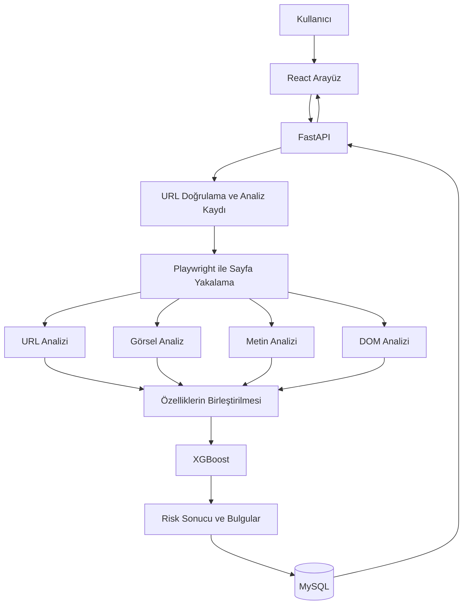

# Sahte Site Avcıları

### Şüphelendiğiniz bağlantıyı açmadan önce kontrol edin.

Sahte Site Avcıları, web adreslerini URL, görsel, metin ve HTML yapısı üzerinden inceleyerek phishing riskini değerlendiren bir web uygulamasıdır.

Kullanıcı tarafından gönderilen adresin özellikleri çıkarılır, sayfa içeriği referans örneklerle karşılaştırılır ve elde edilen bulgular XGBoost modeliyle değerlendirilir. Sonuçlar, risk seviyesi ve inceleme detaylarıyla birlikte kullanıcıya sunulur.

Uygulama, belirli bir marka listesine bağlı kalmadan farklı web sitelerinin değerlendirilmesi için tasarlanmıştır.

## Özellikler

- URL üzerinden phishing risk değerlendirmesi.
- Levenshtein ve Jaro-Winkler ile adres benzerliği incelemesi.
- Ekran görüntüsü üzerinden görsel karşılaştırma.
- TF-IDF ve kosinüs benzerliği ile metin incelemesi.
- Tree Edit Distance ile HTML yapısının karşılaştırılması.
- XGBoost ile birleştirilmiş risk değerlendirmesi.
- Analiz durumunun ve modül bulgularının görüntülenmesi.
- MySQL üzerinde analiz geçmişinin saklanması.
- Önceki analizlerin aranması ve detaylarının görüntülenmesi.
- Türkçe ve farklı ekran boyutlarına uyumlu arayüz.
- Frontend ve backend için tek dosyayla başlatma.
- Backend başlangıcında eksik tabloların otomatik oluşturulması.

## Kullanıcı Arayüzü

Ana sayfa, incelenecek adresin girildiği bir form içerir. Kullanıcı **Analiz et** düğmesiyle incelemeyi başlatır.

Üst menüde iki bölüm bulunur:

- **Analiz** — Yeni adres gönderme ve sonuç inceleme.
- **Geçmiş** — Önceki analiz kayıtlarına erişme.

Sonuç ekranında risk seviyesi, incelenen adres, analiz süresi ve modül bulguları gösterilir. Görsel tasarımda açık arka plan, lacivert metinler ve turkuaz vurgular kullanılır.

## Teknolojiler

| Katman | Teknolojiler |
|---|---|
| Frontend | React, TypeScript |
| Geliştirme ve derleme | Vite |
| Tasarım | Tailwind CSS, Lucide |
| Backend | Python, FastAPI |
| Veri doğrulama | Pydantic |
| Veri tabanı | MySQL |
| Veri tabanı erişimi | SQLAlchemy, PyMySQL |
| Şema yönetimi | Alembic |
| Sayfa yakalama | Playwright, Chromium |
| URL benzerliği | RapidFuzz, Levenshtein, Jaro-Winkler |
| Görsel inceleme | OpenCV, pHash, SSIM |
| Metin inceleme | scikit-learn, TF-IDF, kosinüs benzerliği |
| HTML işleme | BeautifulSoup, lxml, APTED |
| Sınıflandırma | XGBoost |
| Sürüm takibi | Git, GitHub |

## Sistem Mimarisi



Frontend, veri tabanına backend üzerinden erişir. Analiz kayıtları ve modül sonuçları MySQL’de saklanır.

## Çalışma Akışı

1. Kullanıcı incelenecek web adresini gönderir.
2. Backend adresi doğrular ve benzersiz analiz kaydı oluşturur.
3. Sayfanın son adresi, ekran görüntüsü, görünür metni ve HTML içeriği alınır.
4. Dört analiz modülü sayısal özellikler ve bulgular üretir.
5. Özellikler XGBoost modelinde değerlendirilir.
6. Risk seviyesi ve işlem bilgileri veri tabanına kaydedilir.
7. Sonuç kullanıcı ekranına aktarılır.
8. Önceki kayıtlar **Geçmiş** bölümünden görüntülenir.

## Analiz Yöntemleri

### URL Analizi

Adresin alan adı, yolu ve diğer bileşenleri ayrıştırılır. URL uzunluğu, alt alan adı sayısı, rakam oranı ve karakter yapısı gibi özellikler çıkarılır.

Levenshtein ve Jaro-Winkler yöntemleriyle referans adreslere yazımsal yakınlık ölçülür. Benzer görünen farklı alfabe karakterleri için Unicode incelemesi uygulanır.

### Görsel Analiz

Ekran görüntüleri OpenCV ile ortak boyut ve biçime getirilir.

pHash ile yakın görsel adaylar belirlenir. SSIM kullanılarak seçilen adayların görüntü yapısı karşılaştırılır.

### Metin Analizi

Görünür metin temizlenir ve TF-IDF ile vektörleştirilir. Referans metinlerle yakınlık, kosinüs benzerliği üzerinden hesaplanır.

### DOM Analizi

HTML içeriği sadeleştirilmiş bir ağaç yapısına dönüştürülür. Sayfalar arasındaki yapısal farklılık, APTED üzerinden Tree Edit Distance kullanılarak ölçülür.

### XGBoost ile Risk Değerlendirmesi

URL ve içerik özellikleri birleştirilerek XGBoost modeline aktarılır. Model çıktısı, belirlenen eşiklere göre kullanıcıya risk seviyesi olarak sunulur.

Benzerlik ölçümleri ve genel risk sonucu ayrı değerlendirilir. Görsel benzerlik yüzdesi, doğrudan sahtelik olasılığı olarak gösterilmez.

## Sonuç Durumları

| Sonuç | Açıklama |
|---|---|
| Düşük risk | İncelenen özelliklerde düşük risk değerlendirmesi |
| Şüpheli | Karar için yetersiz veya çelişkili bulgular |
| Yüksek phishing riski | Phishing yönünde güçlü bulgular |
| Analiz tamamlanamadı | Teknik nedenle yeterli değerlendirmenin yapılamaması |

İşlem durumu ile risk seviyesi ayrı tutulur. Başarısız bir analiz düşük risk olarak kaydedilmez.

## Veri Tabanı

Veri tabanı adı:

```text
sahte_site_tespit
```

| Tablo | İçerik |
|---|---|
| `analyses` | URL, işlem durumu, risk sonucu, zaman, süre ve hata bilgileri |
| `analysis_modules` | Analize bağlı modüllerin durumları, özellikleri ve bulguları |
| `page_captures` | Sayfa yakalama durumu, son adres, süreler ve dosya yolları (içerik dosyalarda tutulur) |

Her analiz birden fazla modül sonucuyla ilişkilidir.

Backend başlangıcında MySQL bağlantısı kontrol edilir. Eksik tablolar otomatik oluşturulur ve mevcut kayıtlar korunur. Mevcut tablo yapılarındaki değişiklikler migration ile yönetilir.

## Kurulum

### Gereksinimler

- Python ve pip.
- Node.js ve npm.
- MySQL Server.
- Git.
- `baslat.bat` ile başlatma için Windows.

### 1. Repoyu Klonlayın

```bash
git clone https://github.com/Adar485/sahte-site-tespit.git
cd sahte-site-tespit
```

### 2. Frontend Bağımlılıklarını Yükleyin

```bash
cd frontend
npm install
cd ..
```

### 3. Backend Bağımlılıklarını Yükleyin

```bash
python -m pip install -r backend/requirements.txt
python -m playwright install chromium
```

İkinci komut, sayfa yakalamada kullanılan Chromium tarayıcısını indirir. Her iki komut da bir kez (ve bağımlılıklar değiştiğinde) çalıştırılır; uygulama açılışında tekrar kurulum yapılmaz. Ayrıntılar: [backend/README.md](backend/README.md).

### 4. MySQL’i Hazırlayın

MySQL sunucusunu başlatın ve `sahte_site_tespit` adlı veri tabanını oluşturun.

Karakter kümesi olarak `utf8mb4` kullanın.

### 5. Bağlantı Ayarlarını Girin

`backend/.env.example` dosyasını örnek alarak `backend/.env` dosyasını hazırlayın.

```env
DB_HOST=localhost
DB_PORT=3306
DB_NAME=sahte_site_tespit
DB_USER=YOUR_MYSQL_USERNAME
DB_PASSWORD="YOUR_MYSQL_PASSWORD"
```

Değerleri kendi MySQL kurulumunuza göre düzenleyin.

Frontend’in API adresini de kendi `.env.example` dosyasındaki açıklamalara göre yapılandırın.

Gerçek `.env` dosyalarını Git’e eklemeyin.

### 6. Uygulamayı Başlatın

Proje ana klasöründeki `baslat.bat` dosyasına çift tıklayın.

Frontend ve backend ayrı terminal pencerelerinde başlatılır. Frontend terminalinde gösterilen yerel adresi tarayıcıda açın.

Durdurmak için ilgili terminal pencerelerinde `Ctrl + C` kullanın.

## Kullanım

1. **İncelenecek web adresi** alanına bağlantıyı yazın.
2. **Analiz et** düğmesine basın.
3. İşlem durumunu takip edin.
4. Risk sonucunu ve modül bulgularını inceleyin.
5. Önceki analizlere ulaşmak için **Geçmiş** bölümünü açın.

Adres, `https://` öneki olmadan da girilebilir.

## Ekip Çalışması

- Her geliştirici kendi yerel MySQL bağlantısını yapılandırır.
- Yerel bağlantı bilgileri `.env` dosyasında tutulur.
- Paylaşılan `.env.example` dosyaları yalnız örnek değerler içerir.
- Kod değişiklikleri Git üzerinden takip edilir.
- Veri tabanı şema değişiklikleri migration dosyalarıyla paylaşılır.

## Güvenlik ve Sonuçların Yorumlanması

Düşük risk sonucu bir güvenlik garantisi değildir. Bir sayfanın başka bir sayfaya benzemesi tek başına phishing kanıtı oluşturmaz.

Risk sonuçları, inceleme kapsamı ve gözlenen bulgularla birlikte değerlendirilmelidir.
